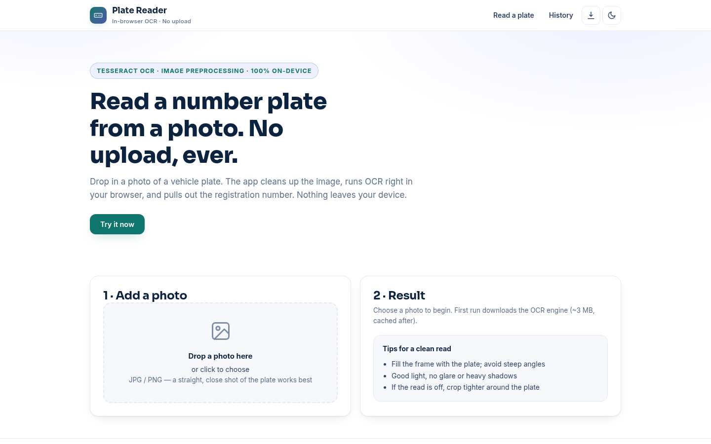
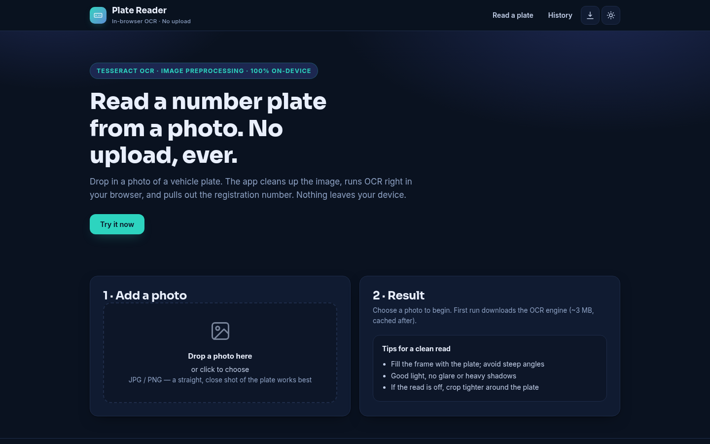
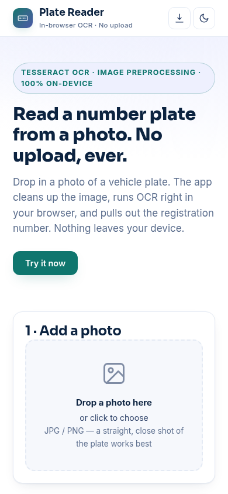

# Plate Reader

**[Live demo →](https://akash991833.github.io/number-plate-reader/)** · [Screenshots](#screenshots) · [How it works](#how-it-works) · [Run it yourself](#run-it-yourself)

Read vehicle number plates from a photo — entirely in your browser. Drop in a photo, the app enhances it, runs OCR on-device, and pulls out the registration number. No upload, no account, no server.

## What it does

- 📷 Drag-and-drop or file picker for plate photos (JPG/PNG)
- 🧼 Automatic preprocessing: upscale, grayscale, contrast stretch, mild binarization — with both stages shown side by side
- 🔤 Tesseract.js OCR with a plate-tuned character whitelist (A–Z, 0–9) and single-block page segmentation
- 🎯 Plate extraction: scores OCR tokens against plate-like patterns (letters+digits, mixed formats) and picks the best candidate — handles spaces and dashes the way real plates (and real OCR) have them
- 📋 One-tap copy, confidence meter, raw OCR text for transparency
- 🕘 Local read history (last 10, this device only)
- 📱 PWA: installable, works offline after first load (OCR engine cached), light + dark themes

## How it works

1. **Preprocess** — the photo is scaled up (min width 1200 px), converted to grayscale, contrast-stretched and gently pushed toward black/white so characters separate cleanly.
2. **OCR** — [Tesseract.js](https://tesseract.projectnaptha.com/) runs the open-source Tesseract engine compiled to WebAssembly, fully on-device (first run downloads ~3 MB of engine + language data, then it's cached).
3. **Extract** — raw OCR text is tokenized; candidates are scored on letter/digit mix, length and typical plate shapes (e.g. letters→digits, sandwiched letters), including joins of adjacent tokens for plates that OCR with spaces.

## Honest limits

- This is **general-purpose OCR tuned for plates, not traffic-camera ANPR**. It does not detect or auto-crop the plate region.
- Clean, straight, close-up photos read well; blurry, angled, dirty or stylized plates can misread — always sanity-check the result.
- It cannot (and does not try to) identify owners or vehicles. Use it for lawful personal purposes only.

## Stack

Vanilla HTML/CSS/JS + [Tesseract.js](https://tesseract.projectnaptha.com/) 5 (WASM OCR, runs fully on-device). Canvas preprocessing (grayscale, contrast boost, thresholding) cleans the plate region before OCR. No build step, no server. Free on GitHub Pages.

## Screenshots

| Desktop (light) | Desktop (dark) | Mobile |
| --- | --- | --- |
|  |  |  |

## Run it yourself

Any static server works:

```bash
python3 -m http.server 8000
# open http://localhost:8000
```

## Tests

`tests/spec.js` generates a synthetic plate photo in-page (border, noise, mono typeface) and runs the real preprocess→OCR→extract pipeline, asserting the registration is recovered end-to-end with Puppeteer.

## License

MIT — free to use, free to learn from.
